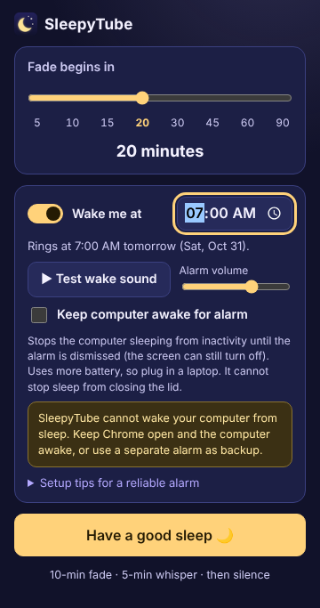
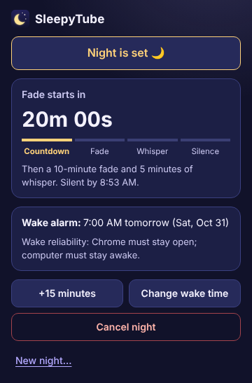
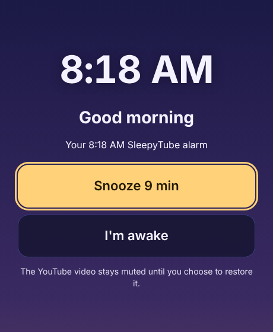

# SleepyTube

**Drift off gently. Wake up softly.**

SleepyTube is a tiny Chrome extension for people who fall asleep to YouTube. It slowly fades the video's sound to silence (without pausing it) and can optionally play a separate, gentle wake-up chime at a time you choose.

It is built to the [product requirements document](SleepyTube_PRD_v1.md) (MVP, v1.0).

<p>
  
  
  
</p>

> **Important:** SleepyTube cannot wake a sleeping computer. The wake alarm only rings if Chrome is open and the computer is awake, so keep a separate alarm as a backup.

## Install (developer mode)

1. Clone this repository.
2. Open `chrome://extensions` and turn on **Developer mode**.
3. Click **Load unpacked** and choose the **`extension/`** folder.
4. Pin SleepyTube to the toolbar.

YouTube tabs that were already open are picked up automatically, so there's no need to reload them.

## Using it

1. Play a video on `www.youtube.com`.
2. Open SleepyTube. Optionally move the **Fade begins in** slider (5–90 minutes, default 20) and turn on **Wake me at**.
3. Press **Have a good sleep 🌙**. With the defaults that's one click.

You can close the popup. A ☾ badge on the toolbar icon means a night is set. Reopen the popup at any time to see the countdown, add **+15 minutes**, change the wake time, or **Cancel night**.

### What happens overnight

Example: armed at 11:00 PM with the default 20-minute countdown and a 7:00 AM wake time.

| Time | What SleepyTube does |
|---|---|
| 11:00 PM | Remembers the video's current volume. |
| 11:20 PM | Starts a smooth 10-minute fade (even in decibels, with eased ends). |
| 11:30 PM | Holds a whisper (4% of the starting volume) for 5 minutes. |
| 11:35 PM | Mutes the video. It keeps playing; SleepyTube never pauses, seeks or changes speed. |
| 7:00 AM | Plays its own bundled chime, rising gently over about 90 seconds, in a wake window with large **Snooze 9 min** / **I'm awake** buttons, plus a notification. |

- **If you change the volume yourself** during the fade, SleepyTube stops fading and asks whether to **Resume fade** (fade again from your new volume) or **Cancel fade**. If you change it before the fade starts, that becomes the new starting volume.
- **The video stays muted after the alarm.** Use **Restore video sound** when you're ready. **Cancel night** restores the volume as a deliberate action.
- **If the alarm can't ring on time** (for example, the computer slept), it's skipped and you're told, rather than going off hours late. It rings if it's less than 10 minutes late.
- The alarm stops by itself after ringing for 15 minutes.
- If the YouTube tab is closed or leaves YouTube, only the fade is cancelled, and you're warned. The wake alarm stays set.

### Making the wake alarm reliable

- Press **Test wake sound** to check the volume and where the sound plays (speakers or headphones).
- Turn on **Keep computer awake for alarm** to stop inactivity sleep until the alarm is dismissed. The screen can still turn off, but this uses more battery, so plug in a laptop. It can't override closing the lid or every OS power policy.
- Leave Chrome running and the system volume unmuted.

## Permissions

| Permission | Why |
|---|---|
| `https://www.youtube.com/*` | Find the main video player and change its volume. Only YouTube, only that one tab. |
| `storage` | Keep tonight's timestamps and your settings on this device. |
| `alarms` | Schedule the fade steps and the wake alarm so they survive the service worker sleeping. |
| `offscreen` | Play the bundled chime in a hidden extension page, independent of the YouTube tab. |
| `notifications` | Secondary Snooze / I'm awake controls, and warnings (tab closed, alarm missed). |
| `scripting` | Reach YouTube tabs that were open before install (only the bundled content script is injected). |
| `power` *(optional)* | Requested only when you turn on **Keep computer awake**; uses the `system` level and is released after the alarm. |

No `tabs`, history, or "all sites" access is requested.

## Privacy

Everything stays on your device. SleepyTube has no account, server, analytics, tracking or ads, and it makes no network requests (its pages are locked down with `connect-src 'none'`). It never reads or stores video titles, URLs, viewing history or audio. See [PRIVACY.md](PRIVACY.md).

## Development

```
extension/             the unpacked extension (load this folder)
  manifest.json
  background.js        service worker: session state machine, alarms, audio, keep-awake
  lib/core.js          shared constants and pure timing/volume logic
  content/content.js   YouTube content script: applies the fade to the <video>
  popup/               toolbar popup
  wake/                wake-up window (Snooze / I'm awake)
  offscreen/           hidden audio player for the chime
  ui/theme.css         shared design tokens
  icons/, sounds/      generated, original assets
tests/                 unit tests (Node) and end-to-end tests (Playwright)
tools/                 asset generator
docs/QA.md             Gate A spike plan, QA matrix, debugging helpers
```

There's no build step: the folder is the extension. Plain JavaScript, no dependencies at runtime.

```sh
npm test                  # unit tests for the timing/volume core (Node 18+)
npm install               # once, for Playwright
npx playwright install chromium
npm run test:e2e          # end-to-end: real extension in Chromium, mock YouTube page
npm run package           # zip extension/ into dist/ for the Chrome Web Store
npm run assets            # regenerate the chime and icons (Python 3, numpy, Pillow, ffmpeg)
```

The end-to-end suite loads the extension into Chromium, serves a stand-in `www.youtube.com` watch page through request interception, and moves time forward with the service worker's debug helper. It covers the full fade timeline, YouTube resetting the volume, player replacement, reload mid-fade, user overrides (before, during and after the fade, and while the alarm rings), +15 minutes (including after mute), cancel/restore, schedule validation, ring/snooze/dismiss, auto-stop, missed alarms (including with the tab gone), tab closure, replacing a night from the same or another tab, service-worker restart, the test sound, keep-awake, editing the wake time, and that other tabs and YouTube's own player settings are never touched.

### How it works

- **Absolute timestamps, not timers.** Arming stores `fadeStartAt`, `fadeEndAt`, `muteAt` and `wakeAt` in `chrome.storage.local`. The content script computes the volume from `Date.now()`, so throttled background tabs make steps coarser but never late. `chrome.alarms` wakes the service worker for each transition.
- **One idempotent reconcile.** Every service-worker start, alarm, and popup open runs `reconcile()`, which brings alarms, audio, keep-awake and the page in line with the stored session. A ring is persisted as `ringing` before any sound starts, so duplicate alarm events or restarts can't start a second ring.
- **State machine.** `IDLE → ARMED → FADING → WHISPER → MUTED → WAKING ⇄ SNOOZED → DISMISSED`, plus `MISSED_WAKE` and `ERROR`; Cancel returns to `IDLE`. The overall state is derived from the fade and wake sub-states (`lib/core.js#describeSession`).
- **Not fighting YouTube or the user.** Volume changes YouTube makes on its own (a new playlist item, an ad, a swapped player) are quietly corrected. Changes within 1.5 s of a click, key or scroll in the page count as the user's, which pauses the fade.
- **Only the video element is muted.** SleepyTube never calls YouTube's player API, so YouTube's saved volume/mute preference (and therefore any YouTube tab opened later) is untouched. Because YouTube's own mute button doesn't know about it, turning the volume up with YouTube's controls unmutes the video, even after the night has ended.
- **A hung tab can't block the alarm.** Calls to the YouTube tab time out after 3 seconds, so Snooze and I'm awake always respond.
- **Wake audio** is a bundled, original Ogg/Opus chime played in an offscreen document with a dB-linear 90-second ramp. If that player reports a failure, the wake window plays the chime itself and the notification becomes audible.

### Debugging

Open `chrome://extensions` → SleepyTube → **service worker** to get a console, then:

```js
await sleepyDebug.session()       // tonight's stored session
await sleepyDebug.fastForward(20) // jump 20 minutes ahead (e.g. to the fade or the alarm)
await sleepyDebug.reset()         // forget tonight's session without touching the video
```

## Release status

Per the PRD's build gates, the **wake alarm needs the Gate A overnight proof on real macOS and Windows machines** before it's offered as an alarm. The automated suite verifies the full ring path in Chromium (offscreen audio starts without a user gesture, snooze/dismiss, idempotency), but it can't prove multi-hour delivery on physical hardware. See [docs/QA.md](docs/QA.md) for the procedure. If it proves unreliable, ship fade-only first.

The chime and icons are generated by `tools/generate_assets.py`, so they're original and royalty-free.
