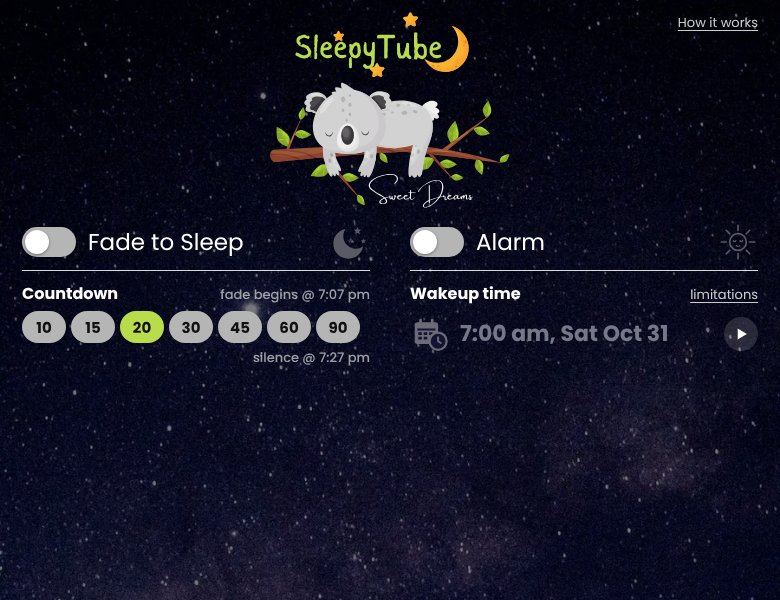
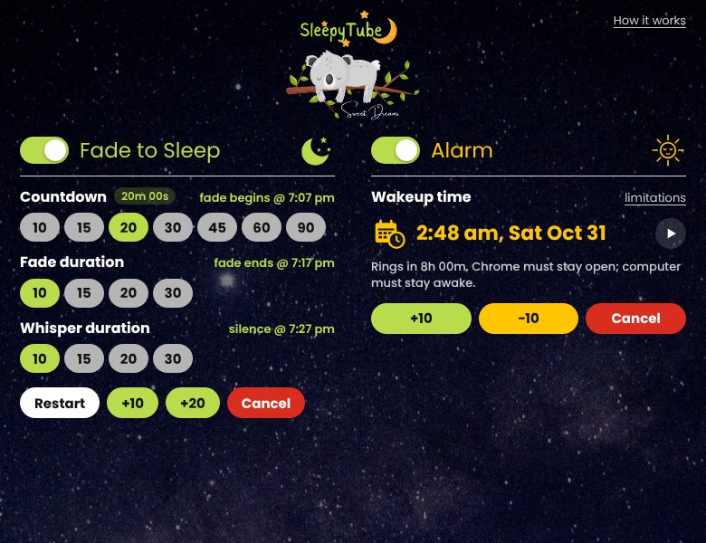
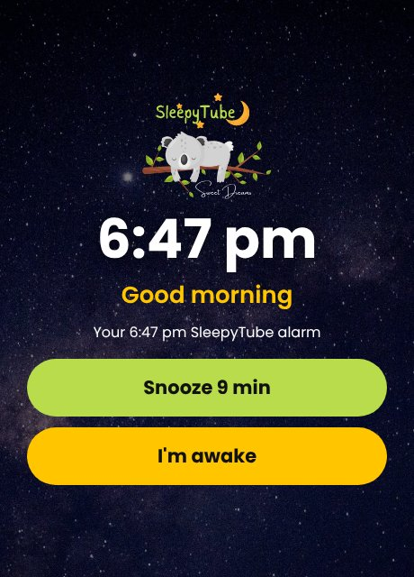

# SleepyTube

**Drift off gently. Wake up softly.**

SleepyTube is a tiny Chrome extension for people who fall asleep to YouTube. It has two switches. **Fade to Sleep** slowly fades the video's sound to silence (without pausing it), and **Alarm** plays a separate, gentle wake-up chime. Use either or both.

It is built to the [product requirements document](SleepyTube_PRD_v1.md) (MVP, v1.0), with the simplified two-switch design that followed it.

<p>
  
  
</p>
<p>
  
</p>

> **Important:** SleepyTube cannot wake a sleeping computer. The wake alarm only rings if Chrome is open and the computer is awake, so keep a separate alarm as a backup.

## Install (developer mode)

**Testers: follow the click-by-click guide in [docs/QA.md, Part 1](docs/QA.md#part-1-install-sleepytube-about-10-minutes).** It needs no Terminal: you download a ZIP from GitHub and load it into Chrome.

In short:

1. Download this repository (green **Code** button → **Download ZIP**) and unzip it, or clone it with Git.
2. Open `chrome://extensions` and turn on **Developer mode**.
3. Click **Load unpacked** and choose the **`extension`** folder inside it.
4. Pin SleepyTube to the toolbar (puzzle-piece icon → pin).

YouTube tabs that were already open are picked up automatically, so there's no need to reload them.

## Using it

Play a video on `www.youtube.com`, open SleepyTube, and flip a switch. With the defaults that's one click.

### Fade to Sleep

| Step | Choices | What happens |
|---|---|---|
| Countdown | 10, 15, **20**, 30, 45, 60, 90 min | Nothing changes yet. |
| Fade | **10**, 15, 20, 30 min | The sound fades smoothly (even in decibels, with eased ends). |
| Whisper | **10**, 15, 20, 30 min | Holds at 4% of the starting volume. |
| Silence | | The video is muted. It keeps playing; SleepyTube never pauses, seeks or changes speed. |

- Each row shows its time ("fade begins @ 11:12 pm", "fade ends @", "silence @"), and the current step shows how long is left. Changing a chip re-plans straight away. Steps that have already started are locked.
- **+10 / +20** keeps the *current* step going longer. During the fade it carries on from the current level, so the sound never jumps back up. It's disabled once the video is silent.
- **Restart** brings the starting volume back and starts the countdown again from now.
- **Cancel**, or switching off, stops the fade and brings the original volume back.
- **If you change the volume yourself**, SleepyTube stops fading and offers **Resume fade** (fade again from your new volume). A change before the fade starts simply becomes the starting volume.
- If the YouTube tab is closed or leaves YouTube, the switch turns off and you get a notice.

### Alarm

- Switch it on to use the time shown (it remembers your last one). The calendar button picks any date and time in the **next 24 hours**; **+10 / −10** nudge it; **Cancel** switches it off. **▶** tests the chime.
- If Fade to Sleep is on, the alarm must be after "silence @", and the fade can't be stretched past the alarm.
- It works without a YouTube tab: the chime is bundled and plays from its own hidden page.
- At wake time, the chime rises gently over about 90 seconds. A wake window opens with large **Snooze 9 min** / **I'm awake** buttons (the popup and a notification have them too). It stops by itself after 15 minutes.
- **Waking never brings the video's sound back.** Switch Fade to Sleep off, or press **Restore video sound** in the wake window, when you're ready.
- **If the alarm can't ring on time** (for example, the computer slept), it's skipped and you're told, rather than going off hours late. It still rings if it's less than 10 minutes late.

The **limitations** link explains what the alarm needs, and holds **Keep computer awake until the alarm** and the alarm volume. **How it works** opens a page of details with no controls.

A ☾ badge on the toolbar icon means something is scheduled, ☀ means the alarm is ringing, and ! means a notice is waiting.

### Making the wake alarm reliable

- Press **▶** to check the volume and where the sound plays (speakers or headphones).
- Turn on **Keep computer awake until the alarm** (under *limitations*) to stop inactivity sleep until the alarm is dismissed. The screen can still turn off, but this uses more battery, so plug in a laptop. It can't override closing the lid or every OS power policy.
- Leave Chrome running and the system volume unmuted.

## Permissions

| Permission | Why |
|---|---|
| `https://www.youtube.com/*` | Find the main video player and change its volume. Only YouTube, only that one tab. |
| `storage` | Keep tonight's timestamps and your settings on this device. |
| `alarms` | Schedule the fade steps and the wake alarm so they survive the service worker sleeping. |
| `offscreen` | Play the bundled chime in a hidden extension page, independent of the YouTube tab. |
| `notifications` | Secondary Snooze / I'm awake controls, and warnings (tab closed, alarm missed). |
| `scripting` | Reach YouTube tabs that were open before install (only the bundled content script is injected). |
| `power` *(optional)* | Requested only when you turn on **Keep computer awake**; uses the `system` level and is released after the alarm. |

No `tabs`, history, or "all sites" access is requested.

## Privacy

Everything stays on your device. SleepyTube has no account, server, analytics, tracking or ads, and it makes no network requests (its pages are locked down with `connect-src 'none'`). It never reads or stores video titles, URLs, viewing history or audio. See [PRIVACY.md](PRIVACY.md).

## Development

```
extension/             the unpacked extension (load this folder)
  manifest.json
  background.js        service worker: session state machine, alarms, audio, keep-awake
  lib/core.js          shared constants and pure timing/volume logic
  content/content.js   YouTube content script: applies the fade to the <video>
  popup/               toolbar popup (two switches + limitations dialog)
  wake/                wake-up window (Snooze / I'm awake)
  info/                "How it works" page (no controls)
  offscreen/           hidden audio player for the chime
  ui/theme.css         shared design: night sky, Poppins, switches, chips, buttons
  images/              logo and night sky (from the design; see tools/prepare_artwork.py)
  fonts/               Poppins (SIL Open Font License), Latin subset
  icons/, sounds/      generated, original toolbar icons and chime
tests/                 unit tests (Node) and end-to-end tests (Playwright)
tools/                 asset generator and artwork preparation
docs/QA.md             Gate A spike plan, QA matrix, debugging helpers
```

There's no build step: the folder is the extension. Plain JavaScript, no dependencies at runtime.

All commands run in Terminal from the repository folder:

```sh
git clone https://github.com/davidsparrow/sleepy-tube.git
cd sleepy-tube            # run everything below from here
npm test                  # unit tests for the timing/volume core (Node 18+)
npm install               # once, for Playwright
npx playwright install chromium
npm run test:e2e          # end-to-end: real extension in Chromium, mock YouTube page
npm run package           # zip extension/ into dist/ for the Chrome Web Store
npm run assets            # regenerate the chime and icons (Python 3, numpy, Pillow, ffmpeg)
python3 tools/prepare_artwork.py logo.svg sky.webp   # re-import the logo and background
```

The end-to-end suite loads the extension into Chromium, serves a stand-in `www.youtube.com` watch page through request interception, and moves time forward with the service worker's debug helper. It covers:

- the full fade timeline, and that other tabs and YouTube's own player settings are never touched;
- chips re-planning a running night (and locking started steps), +10/+20 in each step with no volume jump, Restart, and Cancel;
- YouTube resetting the volume, a swapped player, and a reload mid-fade;
- your own volume changes (before the fade, during it, and after the alarm), and tab closure;
- the alarm time (±10, picker, 24-hour limit, after silence), ring/snooze/dismiss, an alarm-only night, the 15-minute auto-stop and missed alarms;
- a service-worker restart, the test sound, keep-awake, and the info page.

### How it works

- **Absolute timestamps, not timers.** Switching on stores `fadeStartAt`, `fadeEndAt`, `muteAt` and `wakeAt` in `chrome.storage.local`. A mid-fade +10 or chip change re-anchors the curve (`fadeFromAt` / `fadeFromGain`) at the current level. The content script computes the volume from `Date.now()`, so throttled background tabs make steps coarser but never late. `chrome.alarms` wakes the service worker for each transition.
- **One idempotent reconcile.** Every service-worker start, alarm, and popup open runs `reconcile()`, which brings alarms, audio, keep-awake and the page in line with the stored session. A ring is persisted as `ringing` before any sound starts, so duplicate alarm events or restarts can't start a second ring.
- **State machine.** `IDLE → ARMED → FADING → WHISPER → MUTED → WAKING ⇄ SNOOZED`, derived from the two switches (`lib/core.js#describeSession`). Dismissed, missed and lost outcomes turn the relevant switch off and leave a notice; the session is removed once both switches are off.
- **Not fighting YouTube or the user.** Volume changes YouTube makes on its own (a new playlist item, an ad, a swapped player) are quietly corrected. Changes within 1.5 s of a click, key or scroll in the page count as the user's, which pauses the fade.
- **Only the video element is muted.** SleepyTube never calls YouTube's player API, so YouTube's saved volume/mute preference (and therefore any YouTube tab opened later) is untouched. Because YouTube's own mute button doesn't know about it, turning the volume up with YouTube's controls unmutes the video, even after the night has ended.
- **A hung tab can't block the alarm.** Calls to the YouTube tab time out after 3 seconds, so Snooze and I'm awake always respond.
- **Wake audio** is a bundled, original Ogg/Opus chime played in an offscreen document with a dB-linear 90-second ramp. If that player reports a failure, the wake window plays the chime itself and the notification becomes audible.

### Debugging

Open `chrome://extensions` → SleepyTube → **Inspect views: service worker** → **Console** (step-by-step in [docs/QA.md, Part 2](docs/QA.md#part-2-the-debug-console-your-time-machine)), then:

```js
await sleepyDebug.session()       // tonight's stored session
await sleepyDebug.notices()       // notices waiting in the popup
await sleepyDebug.alarmLog()      // recent alarm events: due vs. actual time, sound problems
await sleepyDebug.skipToAlarm()   // make the alarm ring now
await sleepyDebug.fastForward(20) // jump 20 minutes ahead (e.g. to the fade or the alarm)
await sleepyDebug.reset()         // forget tonight's session and notices without touching the video
```

## Release status

Per the PRD's build gates, the **wake alarm needs the Gate A overnight proof on real macOS and Windows machines** before it's offered as an alarm. The automated suite verifies the full ring path in Chromium (offscreen audio starts without a user gesture, snooze/dismiss, idempotency), but it can't prove multi-hour delivery on physical hardware. See [docs/QA.md](docs/QA.md) for the procedure. If it proves unreliable, ship fade-only first.

The chime and toolbar icons are generated by `tools/generate_assets.py`, so they're original and royalty-free. Poppins is bundled under the SIL Open Font License (`extension/fonts/OFL.txt`). The koala logo and night-sky photo come from the design files; confirm their licences before publishing to the Chrome Web Store.
