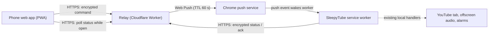
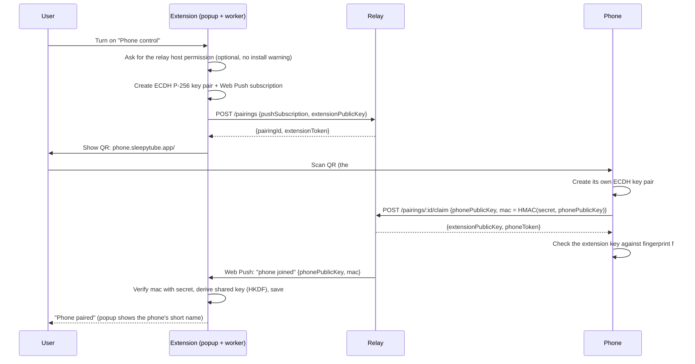

# Design: controlling SleepyTube from your phone

**Status:** Proposal, for review
**Builds on:** the two-switch extension on `main` (Fade to Sleep + Alarm)
**Decision needed from:** product owner (see [Open questions](#13-open-questions))

## 1. Summary

Let someone in bed use their phone to control SleepyTube running in Chrome on their computer: turn Fade to Sleep or the Alarm on and off, use +10 / Restart / Cancel, adjust the alarm time, and Snooze or dismiss. The phone shows the same live status as the popup.

The proposal has four parts:

1. **Phone:** a small web app added to the home screen.
2. **Relay:** a tiny cloud service that passes messages along.
3. **Extension:** wakes up when a command arrives, using **Web Push** into its service worker.
4. **Pairing:** done once by scanning a QR code.

Commands and status are **end-to-end encrypted** between the phone and the extension, so the relay only forwards sealed envelopes. The feature is **opt-in and off by default**. SleepyTube keeps working exactly as today without it.

## 2. Goals and non-goals

**Goals**

- Every popup control is usable from the phone, with status that's at most a few seconds old.
- No accounts: pairing is a single QR scan.
- No new install-time permissions, and nothing changes for people who don't opt in.
- A command that can't be delivered quickly is dropped, never carried out late. This follows the same rule as the late alarm (PRD R6).
- The relay can't read or forge commands, and stores as little as possible.

**Non-goals (for this phase)**

- Waking a sleeping computer, or controlling Chrome after it has been closed. That's impossible from an extension.
- The phone ringing the alarm itself. That's a separate, worthwhile idea (see §12).
- Controlling YouTube playback (play, pause, choosing videos).
- Multiple computers per phone. One computer, up to three phones.

## 3. Constraints that shape the design

| Constraint | Consequence |
|---|---|
| Extensions can't accept incoming connections or open a local port. | The computer must *pull* or be *pushed to*. A relay is unavoidable without a native companion app. |
| The MV3 service worker sleeps after about 30 seconds idle. | A long-lived socket would need constant keep-alives. Web Push wakes the worker on demand instead. |
| Since Chrome 121, extension service workers can subscribe to Web Push with `userVisibleOnly: false` (no notification required). | Silent, on-demand wake-ups are possible. **To be confirmed in the Phase 0 spike.** |
| Chrome on Android and iOS doesn't run extensions. | The phone side has to be a web app (PWA), not an extension. |
| The PRD promises no cloud backend and no network activity (§3 #12, R9, AC12). | The feature must be opt-in, clearly disclosed, and isolated. The PRD and privacy policy need updating. **This is a product decision.** |

## 4. Options considered

| Option | Verdict |
|---|---|
| **Chrome Remote Desktop** (no code) | Works today, but it's clumsy in bed and controls the whole computer. Useful to validate demand before building. |
| **Extension polls the relay** every 30 s or more (chrome.alarms) | Simple, but adds up to 30 s or more of lag, wakes Chrome all night, and wastes battery. |
| **Persistent WebSocket** from the service worker | Fast, but needs 20-second keep-alives to stop the worker sleeping, which means a constantly awake worker and a fragile connection overnight. |
| **Native helper app** on the computer serving the LAN | No cloud, but it's a second install per OS (code signing, firewall prompts). It matches the PRD's future "native companion"; maybe later. |
| **Web Push into the extension** (chosen) | Wakes the worker only when needed, gives near-instant delivery, has built-in expiry (TTL), and uses Google's push infrastructure for delivery. |

## 5. Architecture



**Phone web app**

- A static PWA (for example on Cloudflare Pages) with the same night-sky look and two switches. It can be added to the home screen on iOS and Android.
- It talks only to the relay.
- It keeps its keys in IndexedDB.

**Relay**

- One Cloudflare Worker, with a Durable Object per pairing so commands are ordered and the latest status sits in one place.
- Endpoints:
  - `POST /pairings` (extension creates a pairing)
  - `POST /pairings/:id/claim` (phone joins)
  - `POST /pairings/:id/commands` (phone → extension)
  - `PUT /pairings/:id/status` (extension → phone)
  - `GET /pairings/:id/status` (phone)
  - `DELETE /pairings/:id` (unpair)
- It stores, per pairing:
  - the Web Push subscription;
  - both public keys;
  - hashed device tokens;
  - the latest encrypted status blob.
- Commands aren't stored after they're handed to the push service.

**Extension changes**

- A `push` event listener in `background.js`, registered at top level.
- Pairing and unpairing UI in the popup (a third small control, "Phone", near "How it works"), plus a status upload whenever the session changes.
- **Every command goes through the existing message handlers** (`fade-on`, `fade-extend`, `alarm-shift`, `snooze`, and the rest) via the same serialized queue. Remote and local actions behave identically and share the existing tests.

## 6. Pairing (one QR scan)



- The **QR secret `k` stays in the URL fragment**, so the relay never sees it. The phone proves it scanned the QR by MAC-ing its public key with `k`. The fingerprint `f` lets the phone verify the extension's key. Even a compromised relay can't slip in its own keys.
- Both sides derive an AES-GCM key with ECDH + HKDF (WebCrypto on both ends).
- The QR expires after 10 minutes and works once.
- **Unpair** from the popup or the phone deletes the pairing on the relay and forgets the keys locally.

## 7. Messages

All payloads are AES-GCM encrypted with the pairing key, inside Web Push's own encryption (RFC 8291) on the push leg.

**Command (phone → extension)**

```json
{ "id": "uuid", "issuedAt": 1793380000000, "type": "alarm-shift", "args": { "minutes": 10 } }
```

- Allowed types mirror the popup:
  - `fade-on`, `fade-off`, `fade-retime`, `fade-extend`, `fade-restart`, `fade-resume`;
  - `alarm-on`, `alarm-off`, `alarm-set`, `alarm-shift`;
  - `snooze`, `dismiss`, `dismiss-notice`.
- Anything else is rejected.
- **Expiry:** the relay sends with `TTL: 60` and `Urgency: high`. The extension also drops commands more than 2 minutes old (allowing for clock skew) or whose `id` it has seen before (it remembers the last 200).
- **Which tab for `fade-on`:** the most recently active YouTube tab with a video. If there isn't one, the reply is "No YouTube video is playing on the computer." Video titles are never sent.

**Acknowledgement and status (extension → phone)**

```json
{ "ackFor": "uuid", "ok": true, "message": null,
  "status": { "now": 1793380001234, "state": "FADING", "fade": { "...timestamps and chip choices..." },
              "wake": { "nextRingAt": 1793409000000, "status": "scheduled" }, "notices": ["..."] } }
```

- The status is built from the stored session, the same data the popup renders. It contains **no titles, URLs or tab details**.
- The extension uploads it on every session change (debounced to one per second) and after each command.
- `now` lets the phone correct for clock skew when showing countdowns.

## 8. Phone experience

- **Screens:**
  - **Pair** (camera opens from the QR link);
  - **Control** (the two columns stacked for a phone, with big touch targets);
  - **Can't reach your computer**.
- **Freshness:** "Updated 3 s ago". After 10 s without an acknowledgement, the phone shows: *"Your computer didn't respond. It may be asleep, or Chrome may be closed."* It never retries automatically, to avoid late actions.
- **While the app is open**, it checks the relay for status every 3 s. When it's hidden, it does nothing.
- **Later (optional):** a phone notification when the alarm rings ("Snooze from here"). This needs PWA push: Android works; iOS 16.4+ only after "Add to Home Screen".
- **Night-friendly:** dark only, dimmed brightness, no sounds or haptics except on errors.

## 9. Security and privacy

| Threat | Mitigation |
|---|---|
| Someone else controls your extension | No command is accepted without the pairing key, which only the phone that scanned the QR and the extension hold. Unpair revokes it instantly. |
| Relay compromised or curious | End-to-end encryption. QR secret in the URL fragment. Key fingerprint checked. The relay sees only IDs, sizes and timings. |
| Replayed or delayed commands | Unique IDs, issue-time checks, 60 s push TTL. |
| Lost phone | Unpair from the popup. The phone also has to be unlocked. |
| Abuse or spam of the relay | Device tokens (stored hashed) on every request, rate limits per pairing and per IP, small payload limits. |
| Privacy promise | Opt-in, off by default. No accounts. The relay keeps only pairing records and the latest encrypted status; push metadata logs are kept 7 days or less. Update PRIVACY.md, the Chrome Web Store data disclosures and the PRD. |

**Permissions and policy:**

- Add `optional_host_permissions: ["https://relay.sleepytube.app/*"]`, requested when the user turns the feature on, and change `connect-src` in the extension CSP from `'none'` to that origin only.
- Commands are data, never code, so this stays within the Chrome Web Store remote-code rules.

## 10. Reliability and failure modes

| Situation | What happens |
|---|---|
| Computer asleep, or Chrome closed | Push isn't delivered and expires after 60 s. The phone says the computer didn't respond. Nothing happens later. |
| Service worker asleep | The push event wakes it, it acts, then it sleeps again. |
| Relay down | The phone shows an error. **Everything local keeps working.** The extension never depends on the relay to fade or ring. |
| Push subscription rotated | The `pushsubscriptionchange` handler re-registers with the relay. |
| Phone and popup used at once | Both go through the same serialized queue; the last action wins, and both views update from status. |
| Alarm ringing | The phone shows Snooze / I'm awake prominently. Same handlers, same idempotency rules. |

## 11. Plan and estimate

| Phase | Scope | Estimate |
|---|---|---|
| **0. Spike** | Prove a silent Web Push wakes an idle extension worker on macOS and Windows. Measure latency, behaviour after OS sleep, and TTL expiry. Go/no-go. | 1 day |
| **1. Commands** | Relay (pairing, commands, status), extension push handler and status upload, popup pairing UI, phone control screen. | 3 days |
| **2. Hardening** | Unpair, multiple phones, rate limits, error states, subscription rotation, privacy and Web Store updates. | 1–2 days |
| **3. Optional** | Phone notification when the alarm rings. | 1 day |

**Testing:**

- Unit tests for the envelope (encrypt, decrypt, MAC, expiry, replay) and command validation.
- End-to-end tests with a local relay (`wrangler dev`), injecting push events into the worker, plus a headless "phone" page.
- Manual tests on a real iPhone and Android phone against Mac and Windows computers.
- Add a "Phone control" section to `docs/QA.md`.

## 12. Related idea: the phone as the alarm

The biggest reliability gap today is that **a sleeping computer can't ring**. If there's a phone app anyway, it could also schedule the wake alarm on the phone, as the PRD's "future mobile companion" (§12) suggests. A PWA can't ring reliably in the background on iOS, so this probably means a small native app later. It's worth deciding before investing heavily in the web phone app.

## 13. Open questions

1. **Go or no-go on a backend at all**, given the PRD's "no cloud" stance. Is opt-in plus end-to-end encryption acceptable?
2. **Hosting and domain:** for example `sleepytube.app` on Cloudflare (free tier at small scale). Who owns the account?
3. **Platform priority:** iOS, Android, or both from day one?
4. **Should Phase 3** (a phone notification at alarm time) be in the first release?
5. **Native phone alarm** (§12): is it on the roadmap? That affects whether the phone side should be a PWA or a native app from the start.
